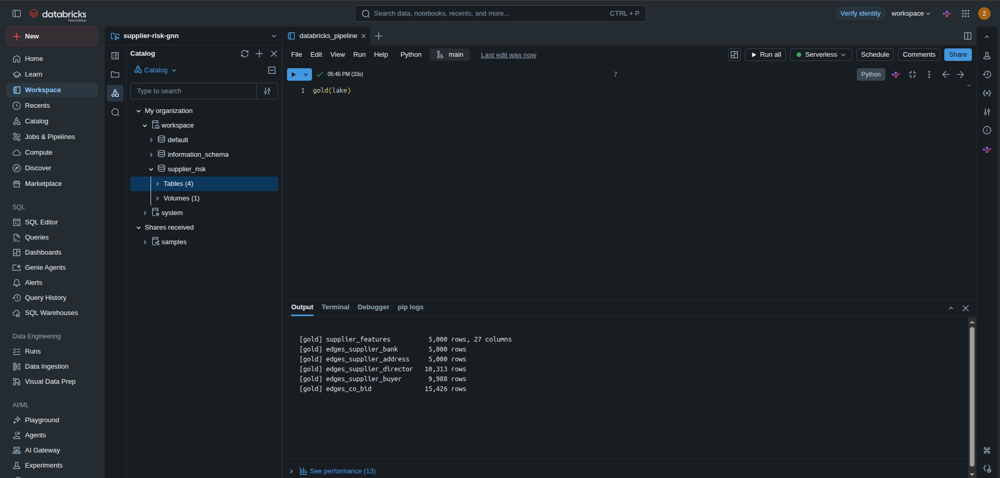
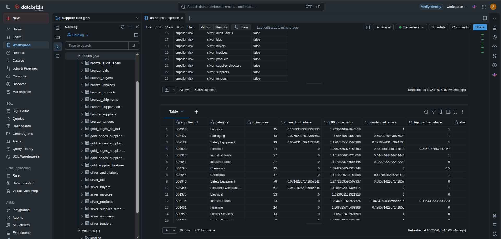
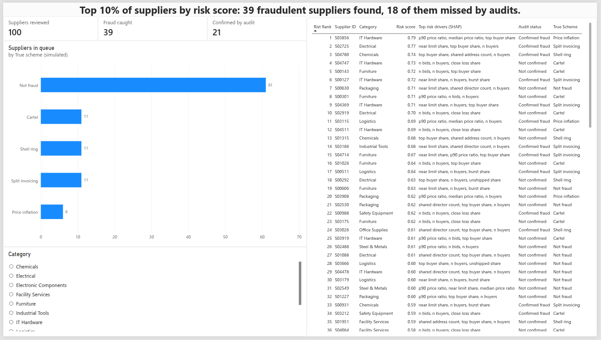
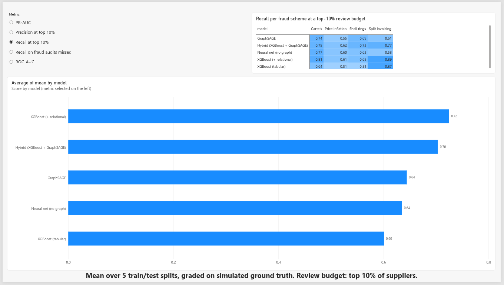
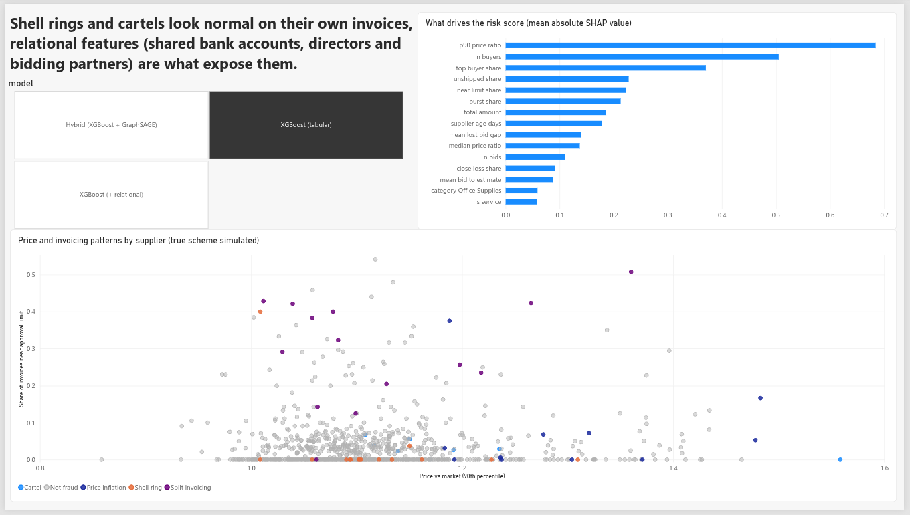

# Supplier Risk Detection with Graph Neural Networks

Detects procurement fraud (shell-company rings, bid-rigging cartels, split invoicing
and price inflation) across a network of suppliers, buyers, invoices, shipments and
tenders. A PySpark lakehouse pipeline builds supplier features and graph edges; a
heterogeneous GraphSAGE model is benchmarked against XGBoost, with SHAP explanations.

**Headline result:** XGBoost with relational features catches 72.5% of fraudulent
suppliers while reviewing only 10% of them (PR-AUC 0.58 against a 6.3% fraud rate).
A stacked GraphSAGE + XGBoost hybrid raises recall on shell-company rings from 65% to
73%, the scheme where fraud is visible only through links between suppliers.

## Contents

- [Why simulated data](#why-simulated-data)
- [Architecture](#architecture)
- [Quick start](#quick-start)
- [Step 1: procurement simulator](#step-1-procurement-simulator)
- [Step 2: lakehouse pipeline](#step-2-lakehouse-pipeline)
- [Steps 3-5: models and evaluation](#steps-3-5-models-and-evaluation)
- [Results](#results)
- [Findings and recommendation](#findings-and-recommendation)
- [Limitations](#limitations)
- [Project structure](#project-structure)

## Why simulated data

Real procurement fraud data is confidential, and no public dataset contains
suppliers, invoices and shipments with fraud labels. The simulator encodes four
schemes from the ACFE (Association of Certified Fraud Examiners) fraud tree,
together with legitimate behaviour that deliberately resembles fraud, so that no
single feature separates the two. The same approach is standard in
anti-money-laundering research (for example, IBM's AMLSim).

## Architecture

```
simulator -> raw CSVs -> bronze -> silver ---------------> gold ---+-> XGBoost (+ SHAP)
             (ERP-style   (as-is)   (typed, enriched,    (supplier   +-> GraphSAGE
              extracts)             addresses resolved)   features,   +-> no-graph ablation
                                                          5 edge      +-> stacked hybrid
                                                          tables)             |
hidden ground truth -------------------------------------------------> evaluation, 5 splits
```

Graph used by GraphSAGE:

```
bank account --+                 +-- buyer
address -------+---- supplier ---+
director ------+        |
                   co-bids with
                     supplier
```

## Quick start

Requires Python 3.11+, Java 17+ (for PySpark) and an NVIDIA GPU for the neural models.

```bash
python -m venv .venv && source .venv/bin/activate
# install PyTorch with CUDA from https://pytorch.org/get-started/locally/ first
pip install -r requirements.txt

python scripts/check_env.py                  # driver, CUDA, PyTorch, PyG, XGBoost GPU, Java
python simulator/simulate.py                 # generate the data (deterministic, seed 7)
python simulator/sanity_check.py             # verify signals and confounders
python pipeline/spark_pipeline.py            # bronze -> silver -> gold
python pipeline/check_entity_resolution.py   # address matching vs ground truth
bash run_models.sh                           # all models on 5 splits -> results/comparison.md
```

## Step 1: procurement simulator

`simulator/simulate.py` generates the tables a procurement system would export:
suppliers, directors, buyers, products, invoices, shipments, tenders, bids and audit
labels. Hidden ground truth is written separately and used only for final evaluation.

| Scheme | How it works | Where the signal is | Legitimate look-alikes |
|---|---|---|---|
| Shell ring | 3-6 suppliers (half newly registered, half aged "shelf" companies) share a bank account, address or director and bill for goods that never ship; about a third are clean-looking fronts | links between suppliers, missing goods receipts | corporate groups sharing directors or accounts; service suppliers with no goods receipts |
| Cartel | established suppliers rig tenders at one buyer: all bid, winners rotate, cover bids sit just above the winner | bidding with the same partners, narrow losing margins, modest price uplift | frequent bidders, premium-priced suppliers |
| Split invoicing | orders split into invoices just under the buyer's approval limit | near-limit invoice share, same-day bursts | contracts priced at the limit, batch invoicing |
| Price inflation | 12-35% above market on 20-50% of invoices | unit price vs market | premium-brand suppliers |

Audits confirm only about half of the fraud, as in reality. Models train on audit
labels and are graded on ground truth, so they are also scored on fraud nobody caught.

Sample run (seed 7): 5,000 suppliers, 185,845 invoices, 2,227 tenders, 10,052 bids,
6.3% true fraud rate.

**Calibrating difficulty.** The first version was too easy: XGBoost alone reached
PR-AUC 0.93, because cartel bids sat far above tender estimates and every shell was
newly registered. Fraud was made subtler and more legitimate look-alikes were added,
bringing the tabular baseline to a PR-AUC of about 0.45.

## Step 2: lakehouse pipeline

`pipeline/spark_pipeline.py` (PySpark) runs locally on Parquet, or on Databricks on
Delta tables via `notebooks/databricks_pipeline.py`.

**Run on Databricks Free Edition** (serverless, Unity Catalog):




| Layer | What happens |
|---|---|
| Bronze | raw extracts stored as-is with ingestion time and source file |
| Silver | types cast, duplicates removed; invoices enriched with market price, approval limit and quantity received; addresses resolved |
| Gold | `supplier_features` (one row per supplier, 27 columns) and five edge tables: supplier-bank, supplier-address, supplier-director, supplier-buyer, supplier-supplier co-bidding |

**Address resolution.** No two raw addresses match as strings ("#12 M.G. Rd,
Bangalore 560 038" vs "No. 12, Mahatma Gandhi Road, Bengaluru 560038"), and 5%
contain typos. The pipeline parses house number, street, pincode and unit,
standardises abbreviations, then fixes typos with Levenshtein matching inside blocks
of the same pincode, house number and unit. Business-park tenants share a building
but not an address; shell companies at a virtual office share both. Results are
measured against ground truth by `pipeline/check_entity_resolution.py`.

**Supplier features:** invoice count and value, buyer count and concentration,
near-limit share, same-day bursts, price vs market (median and 90th percentile),
unshipped share, supplier age, service category, bid count, win rate, bid-to-estimate
ratio, cover-bid signals (losing margin, share of losses within 10%), bidding-partner
concentration, director count, and how many other suppliers share each bank account,
address, building and director.

## Steps 3-5: models and evaluation

**Split.** 60/20/20 by supplier, stratified on audit labels, repeated over 5 random
splits and reported as mean ± standard deviation. A test set holds only about 60
fraudulent suppliers, so a single split can move PR-AUC by ±0.1.

| Model | Inputs |
|---|---|
| `xgb_tabular` | invoice, pricing, shipment, bidding and profile features |
| `xgb_links` | + relational features: suppliers sharing bank account, address, building or director; bidding-partner concentration |
| `mlp_no_graph` | the GraphSAGE network with message passing switched off (ablation) |
| `graphsage` | heterogeneous GraphSAGE over suppliers, bank accounts, addresses, directors, buyers and co-bidding links; 3 seeds per split |
| `xgb_hybrid` | `xgb_links` features + out-of-fold GraphSAGE score (5-fold stacking, no label leakage) |

**Metrics.** PR-AUC, and precision and recall when a team reviews the top 10% of
suppliers, broken down by scheme and for fraud the audits missed. SHAP importance
plots and per-supplier top reasons are written to `results/`.

## Results

Mean ± standard deviation over 5 train/validation/test splits, graded on ground truth.
Best value per column in bold.

**Overall**

| Model | PR-AUC | ROC-AUC | Precision @ top 10% | Recall @ top 10% | Recall on fraud audits missed |
|---|---|---|---|---|---|
| xgb_tabular | 0.454 ± 0.089 | 0.867 ± 0.029 | 0.348 ± 0.067 | 0.601 ± 0.113 | 0.569 ± 0.162 |
| xgb_links | **0.581 ± 0.059** | 0.909 ± 0.009 | **0.420 ± 0.025** | **0.725 ± 0.028** | **0.742 ± 0.086** |
| mlp_no_graph | 0.477 ± 0.040 | 0.869 ± 0.014 | 0.368 ± 0.020 | 0.635 ± 0.023 | 0.639 ± 0.072 |
| graphsage | 0.499 ± 0.062 | 0.874 ± 0.023 | 0.374 ± 0.039 | 0.644 ± 0.048 | 0.633 ± 0.091 |
| xgb_hybrid | 0.540 ± 0.098 | **0.915 ± 0.010** | 0.408 ± 0.044 | 0.703 ± 0.060 | 0.725 ± 0.080 |

**Recall per fraud scheme at a top-10% review budget**

| Model | Shell rings | Cartels | Split invoicing | Price inflation |
|---|---|---|---|---|
| xgb_tabular | 0.510 ± 0.117 | 0.644 ± 0.320 | 0.871 ± 0.072 | 0.506 ± 0.191 |
| xgb_links | 0.652 ± 0.050 | **0.809 ± 0.137** | **0.886 ± 0.074** | 0.611 ± 0.188 |
| mlp_no_graph | 0.627 ± 0.037 | 0.766 ± 0.141 | 0.582 ± 0.023 | 0.599 ± 0.064 |
| graphsage | 0.689 ± 0.029 | 0.744 ± 0.136 | 0.608 ± 0.068 | 0.549 ± 0.143 |
| xgb_hybrid | **0.726 ± 0.032** | 0.746 ± 0.208 | 0.771 ± 0.096 | **0.616 ± 0.115** |

 ## Dashboard (Power BI)

   Built in the Power BI service on the exported tables (`powerbi/data/`). Full report: [PDF](docs/supplier_risk_dashboard.pdf).

   **Review queue**: top 10% of suppliers by risk score, with SHAP reasons. 39 fraudulent suppliers found, 18 of them missed by audits.
   

   **Model comparison**: every metric over 5 splits, and recall per fraud scheme.
   

   **Risk drivers**: SHAP importance per model, and supplier patterns by scheme.
   

## Findings and recommendation

1. **Relational information matters most.** Adding relational features to XGBoost
   raised PR-AUC from 0.454 to 0.581 and recall at the review budget from 60% to 72.5%,
   a gap well beyond the split-to-split variation. It is the best and most stable model.
2. **The graph helps where links are the only evidence.** GraphSAGE and its no-graph
   ablation are within noise overall, but GraphSAGE is consistently better on shell
   rings (0.689 vs 0.627), whose fronts look clean on their own.
3. **The hybrid catches the most shell rings** (0.726 vs 0.652 for `xgb_links`) and
   ranks best overall (ROC-AUC 0.915), but trails `xgb_links` on split invoicing.
4. **Trees beat neural networks on threshold patterns.** Split invoicing is caught at
   0.87-0.89 recall by XGBoost and 0.58-0.61 by the neural models.
5. **Cartel estimates are noisy** (±0.14 to ±0.32), because each test set has only
   about 12 cartel members.

**Recommendation:** use `xgb_links` as the primary risk score (most accurate, most
stable, explainable with SHAP), and add the GraphSAGE hybrid as a secondary
network-risk signal aimed at shell-company rings, where it adds about 7 percentage
points of recall.

## Limitations

- **Simulated data.** Results show what the methods can detect under the encoded
  schemes and look-alikes, not performance on a real company's data.
- **Transductive graph.** GraphSAGE sees the features (never the labels) of all
  suppliers, including test suppliers. This matches periodic batch review; scoring
  brand-new suppliers in real time would need an inductive setup.
- **Incomplete labels.** Uncaught fraud is labelled 0 during training, as in
  practice; ground truth is used only for grading.
- **Address rules** are designed around the spelling variants the simulator produces;
  real addresses would need a postal reference list or a learned matcher.

## Project structure

```
simulator/      simulate.py, sanity_check.py
pipeline/       spark_pipeline.py, check_entity_resolution.py
notebooks/      databricks_pipeline.py
src/            common.py, train_xgb.py, train_gnn.py, compare.py
scripts/        check_env.py
results/        comparison.md, runs/ (per-split metrics), SHAP plots and tables
run_models.sh   trains every model on 5 splits and writes the comparison
```

## Next steps

- Power BI dashboard: supplier risk ranking, recall by scheme, SHAP drivers
- GNNExplainer for per-supplier explanations of the graph model
